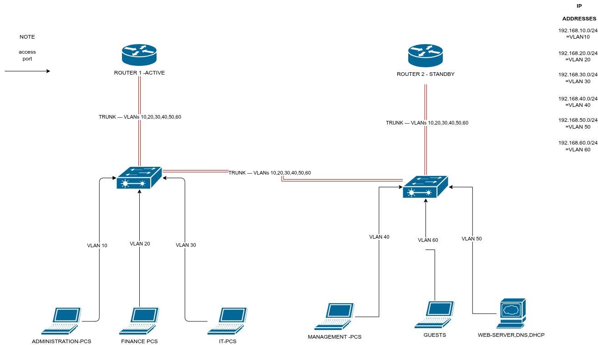

# Enterprise Network Design and Implementation

## 1. Project Overview

This project involves the design, configuration, and implementation of an enterprise network infrastructure using Cisco networking devices in GNS3.

The network is designed to support different departments within an organization through network segmentation, inter-VLAN communication, centralized services, redundancy, and access control.

## 2. Project Objectives

- Design a structured enterprise network infrastructure.
- Implement VLAN-based network segmentation.
- Configure inter-VLAN routing.
- Implement gateway redundancy using HSRP.
- Configure centralized DHCP and DNS services.
- Implement NAT/PAT for external network access.
- Apply Access Control Lists (ACLs) to control network traffic.
- Verify network connectivity and troubleshoot network issues.

## 3. Technologies and Tools

- GNS3 – Network simulation and lab environment.
- Cisco IOSv Routers.
- Cisco IOSvL2 Switches.
- Ubuntu Server.
- Kea DHCP Server.
- BIND9 DNS Server.
- Linux networking tools.

## 4. Network Features

- VLAN segmentation.
- 802.1Q trunking.
- Spanning Tree Protocol (STP).
- Inter-VLAN routing.
- HSRP gateway redundancy.
- DHCP and DNS services.
- NAT/PAT.
- ACL-based traffic filtering.

## 5. Network Architecture

The network consists of two routers, two Layer 2 switches, an Ubuntu server, and end devices distributed across multiple VLANs.

### Network Topology

The following diagram illustrates the enterprise network architecture, including network devices, VLAN segmentation, and interconnections.

## 6. Project Documentation

Detailed network design, configurations, testing evidence, and troubleshooting records are organized in the respective project directories.

## 7. Project Status

Network implementation and verification are documented progressively as part of this engineering portfolio.
